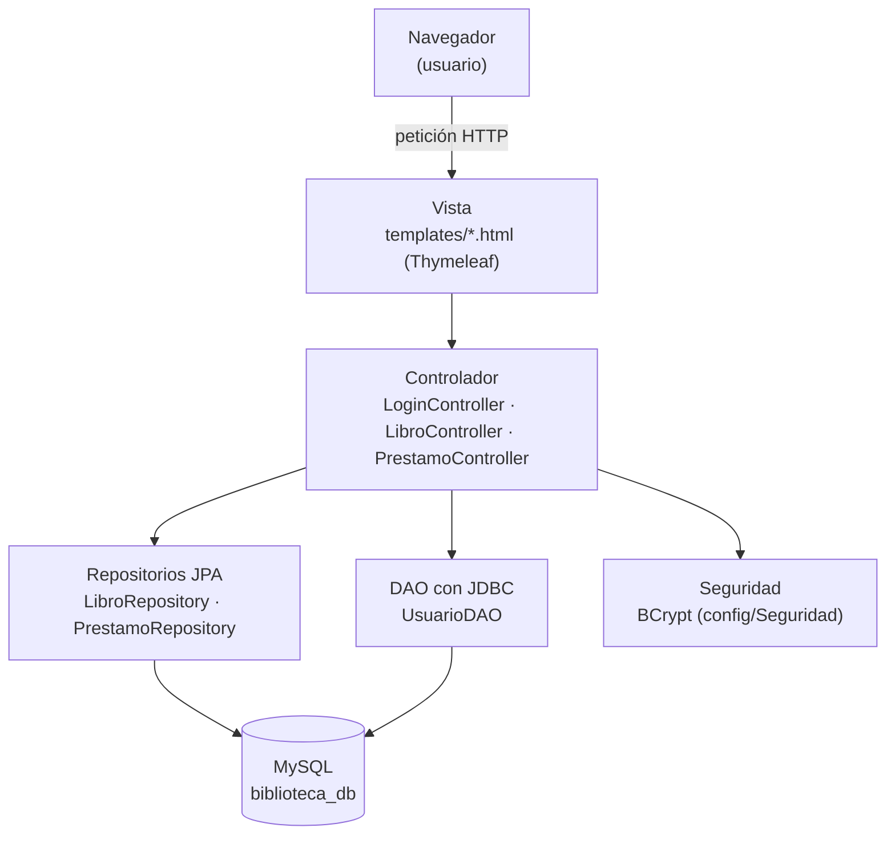
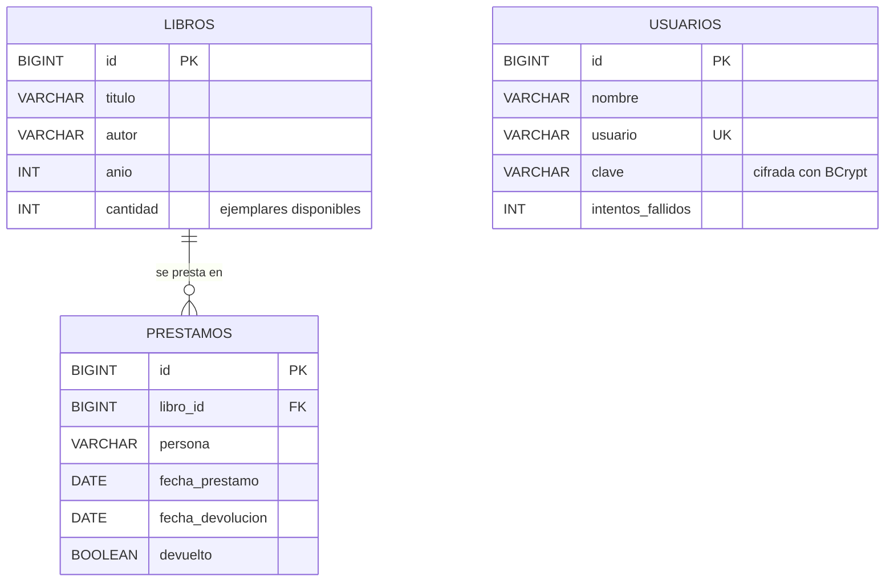

# 📚 Sistema de Gestión Bibliotecaria "El Rincón del Saber"

Sistema web para registrar los libros de una biblioteca, buscarlos, prestarlos y recibir su devolución, con inicio de sesión para varios usuarios. **El Rincón del Saber** es una biblioteca comunitaria **hipotética** de Cúcuta, usada como caso de estudio.

**Proyecto Pedagógico de Aula (PPA)** · Ingeniería de Software · Fundación de Estudios Superiores Comfanorte (FESC)

| Integrante | Rol en el proyecto |
|---|---|
| **Kevin Andrés Castañeda Linares** | Base de datos MySQL, conexión JDBC (`UsuarioDAO`) y seguridad de usuarios: login, registro, BCrypt y bloqueo por intentos |
| **Daniel Sandoval** | Módulo de libros (registrar, editar, eliminar y buscar), módulo de préstamos y devoluciones, y vistas HTML/CSS |

---

## Tecnologías

| Tecnología | Uso |
|---|---|
| Java 17 | Lenguaje de programación |
| Spring Boot 3.3 | Servidor web y organización del proyecto |
| Spring Data JPA (Hibernate) | Acceso a las tablas `libros` y `prestamos` |
| **JDBC** (`DataSource`, `PreparedStatement`) | Acceso a la tabla `usuarios` |
| **BCrypt** (spring-security-crypto) | Cifrado de contraseñas |
| Thymeleaf, HTML y CSS | Vistas |
| MySQL (XAMPP) | Base de datos `biblioteca_db` |
| DBeaver | Administración de la base de datos |
| JUnit 5 y Mockito | Pruebas unitarias |
| Maven | Dependencias y compilación |

---

## Arquitectura

El proyecto usa una **arquitectura en capas con el patrón MVC (Modelo, Vista, Controlador)**. Cada capa solo habla con la que tiene al lado:



| Capa | Paquete / carpeta | Qué hace |
|---|---|---|
| **Vista** | `src/main/resources/templates` | Pantallas: `login`, `registro`, `libros`, `prestamos` |
| **Controlador** | `controller` | Recibe los clics y formularios, valida y decide qué mostrar |
| **Modelo** | `model` | Clases que representan las tablas: `Usuario`, `Libro`, `Prestamo` |
| **Acceso a datos** | `repository` y `dao` | Consultas a MySQL: JPA para libros y préstamos, JDBC para usuarios |
| **Configuración** | `config` | Cifrador BCrypt y cifrado de claves antiguas al arrancar |

### Conexión a la base de datos

Está en `src/main/resources/application.properties`:

```properties
spring.datasource.url=jdbc:mysql://localhost:3306/biblioteca_db
spring.datasource.username=root
spring.datasource.password=
```

Con estos datos Spring crea un `DataSource`. `UsuarioDAO` lo usa con JDBC:

```java
try (Connection con = dataSource.getConnection();
     PreparedStatement ps = con.prepareStatement("SELECT ... FROM usuarios WHERE usuario = ?")) {
    ps.setString(1, usuario);
    try (ResultSet rs = ps.executeQuery()) { ... }
}
```

---

## Base de datos

Script: [`database/biblioteca_db.sql`](database/biblioteca_db.sql)



La llave foránea `prestamos.libro_id → libros.id` impide borrar un libro que tiene préstamos.

---

## Funcionalidades

- Inicio de sesión y registro de **varios usuarios**.
- Registrar, editar, eliminar y **buscar libros** por título o autor, con el total de ejemplares.
- **Prestar** un libro (resta 1 ejemplar) y registrar su **devolución** (suma 1 ejemplar).
- Lista de préstamos pendientes y devueltos.

## Seguridad de los usuarios

| Medida | Dónde |
|---|---|
| Contraseñas cifradas con **BCrypt**, nunca en texto plano | `LoginController`, `config/Seguridad` |
| Consultas con **PreparedStatement** contra la inyección SQL | `dao/UsuarioDAO` |
| **Bloqueo** de la cuenta tras 3 intentos fallidos | `LoginController`, columna `intentos_fallidos` |
| Contraseña de mínimo 6 caracteres con letras y números | `LoginController.registrar` |
| Sesión nueva al entrar y cierre a los 15 minutos sin uso | `LoginController`, `application.properties` |
| Sin sesión no se puede entrar a `/libros` ni a `/prestamos` | `LibroController`, `PrestamoController` |

---

## Pruebas unitarias

Se hicieron con **JUnit 5** y **Mockito**. Mockito **simula** la base de datos, así que las pruebas corren sin tener MySQL encendido y prueban solo la lógica de cada clase.

Ubicación: `src/test/java/com/biblioteca/controller`

| Clase de prueba | Responsable | Qué prueba |
|---|---|---|
| `LibroControllerTest` | Daniel | 1. La búsqueda muestra solo los libros que coinciden y suma sus ejemplares<br>2. Sin iniciar sesión, manda al login<br>3. No deja eliminar un libro con préstamos |
| `LoginControllerTest` | Kevin | 1. Login correcto entra y reinicia los intentos (sin guardar la clave en la sesión)<br>2. Clave incorrecta no entra y suma un intento<br>3. Con 3 intentos fallidos queda bloqueado<br>4. El registro rechaza contraseñas débiles<br>5. El registro guarda la contraseña cifrada con BCrypt |
| `PrestamoControllerTest` | Daniel | 1. Prestar descuenta un ejemplar y guarda el préstamo<br>2. No presta si no hay ejemplares<br>3. Devolver suma el ejemplar y marca devuelto |

**Cómo correrlas:** en IntelliJ, clic derecho en `src/test/java` → *Run 'All Tests'*, o con Maven:

```bash
mvn test
```

---

## Cómo ejecutar el proyecto

1. Abrir XAMPP y encender **MySQL** (puerto 3306).
2. En DBeaver, ejecutar `database/biblioteca_db.sql` (crea la base y las tablas). Opcional: `database/datos_ejemplo.sql` para cargar 30 libros y préstamos de prueba en una base vacía.
3. Abrir el proyecto en IntelliJ y ejecutar `BibliotecaApplication`.
4. Entrar a **http://localhost:8080**. Usuario de prueba: `admin`.

## Estructura del proyecto

```
Biblioteca/
├── database/                 Scripts SQL
├── src/main/java/com/biblioteca/
│   ├── config/               Seguridad (BCrypt)
│   ├── controller/           Controladores
│   ├── dao/                  Acceso con JDBC
│   ├── model/                Entidades
│   └── repository/           Repositorios JPA
├── src/main/resources/
│   ├── templates/            Vistas HTML
│   ├── static/css/           Estilos
│   └── application.properties
├── src/test/java/            Pruebas unitarias
└── pom.xml
```
